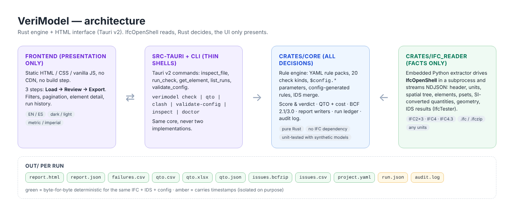
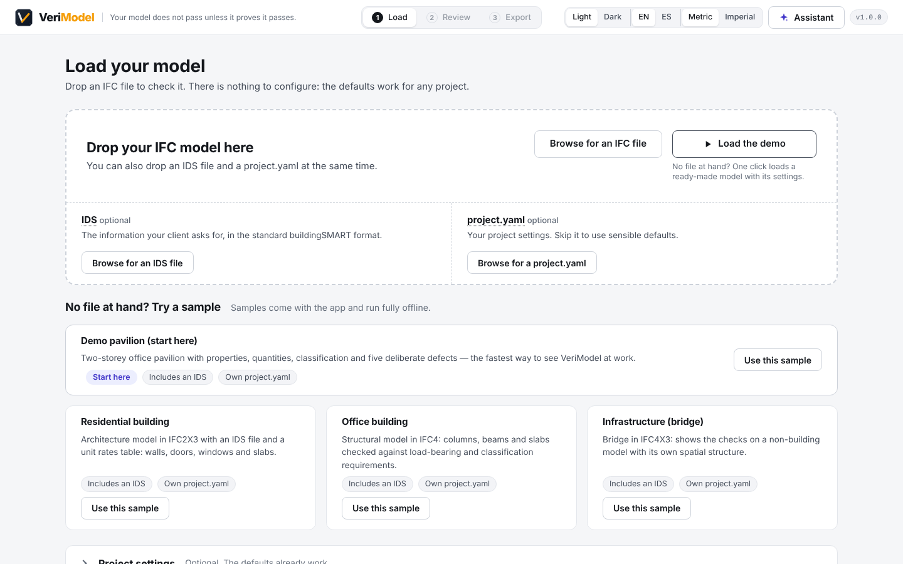
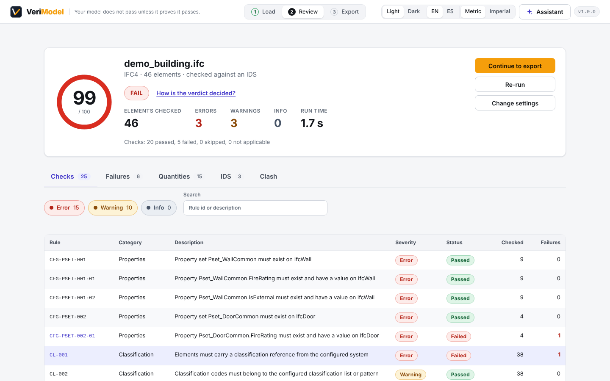
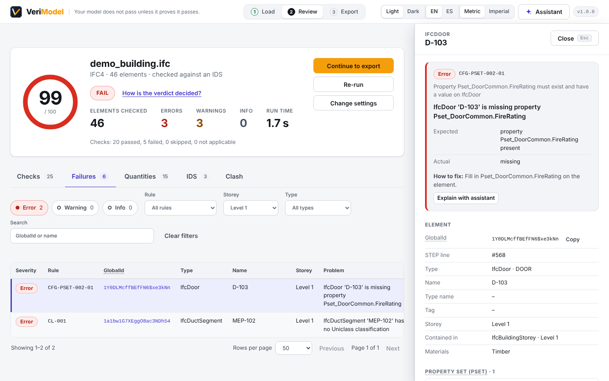
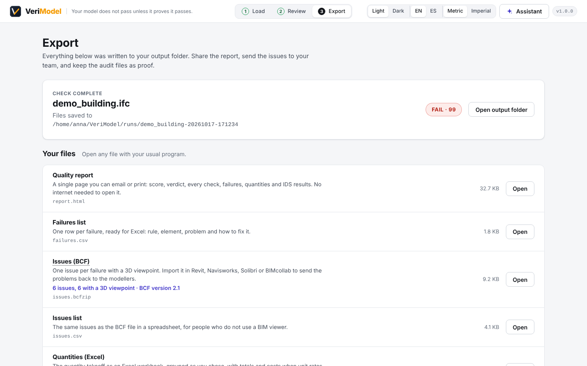
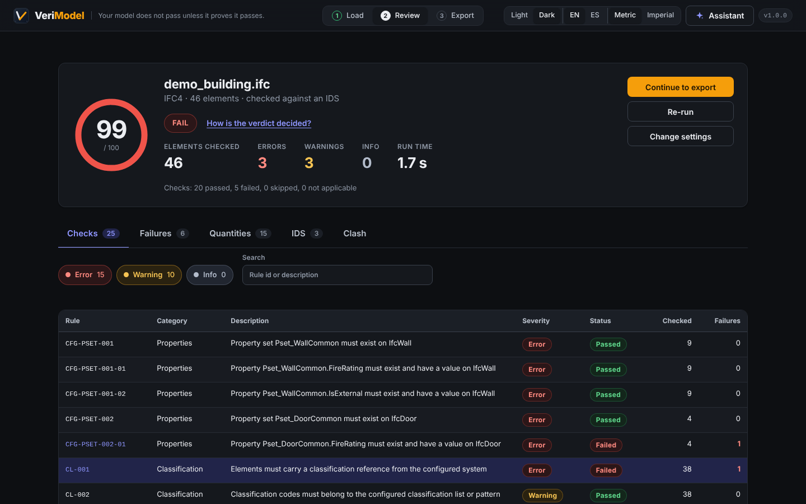
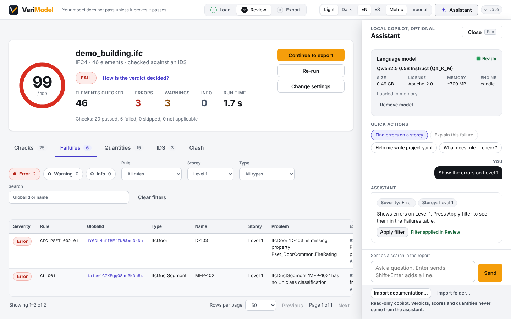

# VeriModel

> **Your model does not pass unless it proves it passes.**

VeriModel is a local-first desktop application and CLI: **IFC QA Gate + Quantity Takeoff (QTO) + BCF Export**.

It takes **any** IFC model from **any** BIM project and answers, with proof:

1. **Is this model compliant** with the project's requirements (buildingSMART IDS + a configurable rule pack)?
2. **How much is in it** (quantities, optionally priced with your own unit rates)?
3. **What is wrong, exactly where**, in a format a coordinator can open in any BCF tool?

Not a bot that clicks. Not a flow builder. A quality gate a model must cross with evidence: deterministic checks, a run ledger with SHA-256 hashes, and outputs that are byte-for-byte reproducible.



## Contents

- [Why VeriModel](#why-verimodel)
- [Quickstart](#quickstart)
- [UI walkthrough (3 steps)](#ui-walkthrough-3-steps)
- [CLI](#cli)
- [Outputs of a run](#outputs-of-a-run)
- [Configuration (`project.yaml`)](#configuration-projectyaml)
- [Rules and rule packs](#rules-and-rule-packs)
- [IDS](#ids)
- [Quantity takeoff](#quantity-takeoff)
- [BCF export](#bcf-export)
- [Architecture: why hybrid Rust + IfcOpenShell](#architecture-why-hybrid-rust--ifcopenshell)
- [Demo script](#demo-script)
- [Tests](#tests)
- [Assumptions](#assumptions)
- [Limitations](#limitations)
- [License](#license)
- [Dependencies and licenses](#dependencies-and-licenses)

## Why VeriModel

- **Verifiable, not vibes.** Every number has evidence one click away. Deterministic code decides pass/fail; no LLM is involved in any verdict.
- **Generic by design.** Any building or infrastructure type, any discipline, IFC2x3 / IFC4 / IFC4.3 (auto-detected), any units (read from the file, converted to SI internally), any classification system, any naming convention. Everything project-specific lives in `project.yaml` and `.ids`, never in Rust code. There is no `if project == X`, no hardcoded list of element types, property names or storey names.
- **Pluggable rules.** A rule is data: `{id, description, scope, check, severity, fix_hint}` in YAML. New rules are added by adding a YAML entry, not by editing the engine.
- **Local-first.** No accounts, no cloud, no telemetry, no CDN at run time. All data stays on the machine.
- **Standards-based.** IFC, buildingSMART IDS 1.0, BCF 2.1 and 3.0 (validated against the official XSDs).
- **Source-available.** PolyForm Noncommercial 1.0.0: free for any noncommercial purpose; commercial licences on request (see [License](#license)).

## Quickstart

### Prerequisites

| Need | Why | Install |
|---|---|---|
| Rust 1.80+ | engine, CLI, desktop shell | <https://rustup.rs> |
| Python 3.9+ with `ifcopenshell` and `ifctester` | the IFC reader bridge (parsing, geometry, IDS) | `pip install ifcopenshell ifctester` |
| Tauri v2 system deps (Linux only) | desktop app | `libwebkit2gtk-4.1-dev libayatana-appindicator3-dev librsvg2-dev patchelf` |
| `cargo tauri` CLI (only to build the desktop app) | bundling | `cargo install tauri-cli --version "^2" --locked` |

`verimodel doctor` tells you whether Python and IfcOpenShell are found. Set `VERIMODEL_PYTHON=/path/to/python` to point at a specific interpreter.

### CLI

```bash
cargo build --release -p verimodel-cli
./target/release/verimodel check \
  --ifc tests/fixtures/bsi_ifc4_building_structural.ifc \
  --ids examples/sample.ids \
  --config examples/residential/project.yaml \
  --out ./out
```

Exit code `0` = PASS / PASS WITH WARNINGS, `1` = FAIL, `2` = bad input, `3` = feature not implemented (clash).

### Desktop app (development)

```bash
cargo tauri dev        # opens the VeriModel window with the static frontend
```

### Desktop app (installers)

```bash
cargo tauri build      # Windows .msi + .exe (NSIS), macOS .dmg, Linux .AppImage + .deb
```

One version number (`Cargo.toml` → workspace `version`) is used by the CLI, the app and every installer.

## UI walkthrough (3 steps)

The UI is a stepper: **1 Load → 2 Review → 3 Export**. One primary action per screen; every term has a tooltip; errors are plain language with a hint, never a stack trace (those go to the log file).

### 1 · Load

Drop an IFC (plus optional IDS and `project.yaml`), click **Load the demo** (a two-storey pavilion with five deliberate defects, its settings and an IDS, the fastest way to see the tool work), or try one of the three bundled buildingSMART samples. The file card shows the name, SHA-256, schema, size, element count, units, disciplines and storeys. "Project settings" (collapsed by default) edits the rule pack, tolerances, classification, QTO grouping and currency and writes a reusable `project.yaml`. Defaults work with zero configuration.



### 2 · Review

Score (0–100), verdict badge (PASS / PASS WITH WARNINGS / FAIL), counts and run time. Tabs: **Checks** (per-rule pass/fail/skipped with reason), **Failures** (one row per element per rule, with expected vs actual and a fix hint; click a row for the element's properties and quantities), **Quantities**, **IDS**, **Clash**. Filters by severity, rule, storey, type, and search by GlobalId or name. Pagination keeps large failure lists fast.





### 3 · Export

One list of downloads with plain descriptions, plus the run history with a diff against the previous run of the same file ("12 fewer errors than last run").



Dark theme, Spanish UI, and imperial display units are toggles in the top bar; all three persist.



### Assistant (optional)

The **Assistant** button in the header opens a side panel (Escape closes it) with a small language model that runs on your computer. It is optional: the model is not bundled, you download it once from the panel (about 0.5 GB from Hugging Face), and nothing about your model leaves the machine. It helps you:

- **find** things ("show the errors on Level 1" proposes a filter you apply with one button; values that are not in the report are dropped and listed),
- **understand** a failure ("Explain with assistant" in the element detail),
- **configure** (it drafts a `project.yaml` fragment, marked Valid or Invalid by the real config parser; "Use in settings" only works when it is valid),
- and **look things up** in the built-in docs, the current report and your own documentation (**Import documentation…** accepts .md, .txt, .yaml, .json, .docx and .pdf; "Save knowledge.yaml" keeps the converted text).

It is a read-only copilot: verdicts, scores and quantities are computed by the engine and never come from the assistant, and nothing changes until you press a button.



## CLI

```text
verimodel check            --ifc model.ifc [--ids spec.ids] [--config project.yaml] [--out ./out] [--no-geometry] [--json]
verimodel qto              --ifc model.ifc [--config project.yaml] [--out ./out]
verimodel clash            --ifc-a a.ifc --ifc-b b.ifc [--config project.yaml] [--out ./out]   # phase 2: explicit "not implemented"
verimodel validate-config  --config project.yaml [--schema]
verimodel inspect          --ifc model.ifc
verimodel doctor
verimodel ask              --question "What does rule CL-001 check?" [--report out/report.json] [--app-data DIR]
verimodel assistant status   [--app-data DIR]
verimodel assistant download [--app-data DIR]
verimodel docs-to-yaml     --in docs/ bep.docx naming.pdf --out knowledge.yaml
```

The CLI and the desktop app call the same `verimodel-core` functions; there is one implementation of every check, quantity and writer.

### Assistant commands

The optional local assistant (see "Assistant" above) is also available headless. The model lives in `<app-data>/assistant/`; by default `<app-data>` is the desktop app's data folder (`~/.local/share/io.verimodel.desktop` on Linux, `~/Library/Application Support/io.verimodel.desktop` on macOS, `%APPDATA%\io.verimodel.desktop` on Windows), so the CLI and the app share one download. Set `VERIMODEL_APP_DATA` or pass `--app-data` to use another folder.

- `verimodel assistant status` shows whether the model is installed, its size, license and memory need.
- `verimodel assistant download` downloads it once (progress on stderr).
- `verimodel ask --question "..."` answers from the built-in docs; add `--report out/report.json` to ask about a run. If the model is not installed it prints a plain-language hint and exits with code 2.
- `verimodel docs-to-yaml --in <files or folders> --out knowledge.yaml` converts documentation to the assistant's knowledge format (no model needed) and prints the files read, the files skipped and the chunk count.

The assistant only prints text. It never changes a verdict, a score or a quantity.

## Outputs of a run

Every run writes an `out/` folder:

| File | What it is | Deterministic |
|---|---|---|
| `report.html` | Human-readable report: summary, per-rule table, failures, quantities, IDS, clash | yes |
| `report.json` | The same data, machine-readable | yes |
| `failures.csv` | One row per element per rule | yes |
| `qto.csv`, `qto.xlsx`, `qto.json` | Quantities per group, totals, cost, hand-check samples | yes |
| `issues.bcfzip` | BCF 2.1 (or 3.0) issues, one topic per ERROR/WARNING | yes, except creation dates |
| `issues.csv` | The same issues for Excel | yes |
| `project.yaml` | The exact configuration used | yes |
| `run.json` | Run ledger: input SHA-256s, tool version, timestamp, duration, counts, score, SHA-256 of `report.json` | carries the timestamp |
| `audit.log` | Append-only trail of what ran | carries timestamps |

Same IFC + same IDS + same config ⇒ identical `report.json`, `failures.csv`, `qto.*`, `report.html` and `issues.csv`, byte for byte. This is enforced by a test.

## Configuration (`project.yaml`)

Everything project-specific. Every field has a default; unknown keys are rejected so a typo can never silently disable a check. Full reference: [docs/CONFIG.md](docs/CONFIG.md). Three complete examples for different project types live in [`examples/`](examples/README.md).

```yaml
project:
  name: "Generic Project"
  language: en            # en | es
  units: auto             # auto | metric | imperial (display only; the engine works in SI)
  classification_system: Uniclass
  ifc_versions: [IFC2X3, IFC4, IFC4X3]
requirements:
  ids_file: spec.ids      # optional, source of truth when given
  rule_pack: generic      # or a path to a custom rule pack YAML
  required_psets:         # each entry generates rules, no code involved
    - pset: Pset_WallCommon
      applies_to: [IfcWall]
      properties: [FireRating, IsExternal]
tolerances:
  far_from_origin_m: 10000
  geometry: { min_volume_m3: 0.000001, min_area_m2: 0.000001, max_extent_m: 5000 }
qto:
  group_by: [type, storey]     # type | storey | classification | material | predefined_type | type_name
  unit_rates_file: rates.csv   # optional cost estimate
  currency: EUR
classification:
  required: false
  code_pattern: '^[A-Z][a-z]_[0-9]{2}(_[0-9]{2}){0,3}$'
naming:
  patterns: { IfcWall: '^W-[0-9]{3}$' }
checks:
  rules: { ID-003: false }      # toggle any rule
  categories: { naming: false } # or a whole category
clash:
  enabled: false                # phase 2
output:
  language: en
  bcf_version: "2.1"            # or "3.0"
```

`verimodel validate-config --config project.yaml --schema` prints the JSON schema.

## Rules and rule packs

The built-in generic pack is a data file: [`crates/core/rule_packs/generic.yaml`](crates/core/rule_packs/generic.yaml). It covers the seven check categories:

| Category | Rules | Examples |
|---|---|---|
| A · Identity | ID-001..003 | duplicate GlobalId, invalid GlobalId, duplicate names within type + storey |
| B · Spatial | SP-001..004 | element not in any storey, container missing from hierarchy, site/building/storey (or facility/part) missing, far from origin |
| C · IDS | IDS-ss-rr | generated from the IDS file, requirement quoted |
| D · Properties | PR-001 + CFG-PSET-* | empty values, required psets/properties from `project.yaml` |
| E · Geometry | GEO-001..003 | no representation, degenerate shape, bounding box beyond project bounds |
| F · Classification & naming | CL-001..002, NAM-001 | missing classification, code outside the configured list/pattern, name pattern |
| G · Sanity | QT-001..002, SCH-001 | zero volume / area where a quantity is reported, schema accepted by the project |

A rule looks like this; `$config.<path>` pulls a value from `project.yaml`:

```yaml
- id: SP-004
  category: spatial
  description: Elements must not be far from the project origin
  severity: warning
  scope: { ifc_types: [IfcElement] }
  check: { kind: distance_from_origin, max_m: "$config.tolerances.far_from_origin_m" }
  fix_hint: Move the model close to the origin or set the shared coordinates correctly.
```

To add a custom rule: copy `generic.yaml`, add an entry using any of the 20 check kinds (`unique_global_id`, `property_exists`, `property_matches`, `classification_exists`, `name_matches`, `quantity_positive`, `types_present`, …), and point `requirements.rule_pack` at your file. The engine code does not change. Scopes use IFC supertypes (`IfcElement`, `IfcDistributionElement`) so they work in every schema. Every check kind, its parameters and the score formula are documented in [docs/RULES.md](docs/RULES.md).

A check that cannot run (for example geometry when the kernel is unavailable) is reported as **SKIPPED with a reason**, never as PASS.

**Verdict and score.** FAIL = at least one ERROR. PASS WITH WARNINGS = no errors, at least one WARNING. PASS = neither. Score = 100 × (1 − (errors + 0.25 × warnings) / element checks), where "element checks" is the number of (element, rule) pairs evaluated. The UI and the report show this sentence verbatim.

## IDS

Give VeriModel an `.ids` file (buildingSMART Information Delivery Specification 1.0) and it becomes the source of truth: every specification/requirement pair becomes a rule `IDS-ss-rr`, every failing entity a finding whose *expected* column quotes the requirement text verbatim ("FireRating data shall be provided in the dataset Pset_WallCommon"). The IDS engine is IfcTester (part of the IfcOpenShell project); VeriModel reads its facts and decides. A minimal IDS and a walkthrough of how to write one are in [docs/IDS.md](docs/IDS.md) and [`examples/sample.ids`](examples/sample.ids).

## Quantity takeoff

- Quantities come from `IfcElementQuantity` / base quantities when present (`NetVolume`, `GrossVolume`, `NetArea`, `Length`, …), converted to SI using the file's `IfcUnitAssignment`.
- Fallback: volume, area and length are computed from the tessellated geometry by IfcOpenShell. **Every row records how many values came from each source**, and the report explains the method in plain language.
- Grouping is configurable (`qto.group_by`): type, storey, classification, material, predefined type, type name, or any combination.
- Cost: `rates.csv` (`code, description, unit, rate, currency, match_type, match_storey, match_classification`) prices each group; the rate code and source file are shown per row so the estimate is auditable.
- Reconciliation: the report lists five sample elements with GlobalId, type, quantity and calculation method for a hand check. The end-to-end tests reconcile the broken fixture against hand-computed volumes (5 m × 3 m × 0.2 m = 3.0 m³, …).

## BCF export

One `.bcfzip` per run with one topic per ERROR and WARNING: title, description (rule, element, expected vs actual, fix hint), status, priority, author, creation date, labels, the element's GlobalId as a viewpoint component and a perspective camera framing its bounding box. BCF 2.1 by default, BCF 3.0 with `output.bcf_version: "3.0"`. Topic GUIDs are UUID v5 of the input hash + rule + element, so re-runs produce the same topics. The writer is validated against the official BCF-XML XSDs (2.1 and 3.0) and opened with the open-source `bcf-client` library used by Bonsai; a BCF 2.1 file produced here opens in Bonsai (Blender), BIMcollab Zoom and Solibri, which all read BCF 2.1.

## Architecture: why hybrid Rust + IfcOpenShell

```
verimodel/
  crates/core/        PURE Rust: rule engine, QTO, BCF, report, audit, config. No IFC dependency.
  crates/ifc_reader/  The ONLY crate that touches IFC: drives IfcOpenShell (Python) and returns facts.
  crates/cli/         `verimodel` binary, shares core with the desktop app.
  src-tauri/          Tauri v2 shell: commands, file dialogs, bundling.
  frontend/           Static HTML/CSS/JS, presentation only.
  examples/           Three project.yaml for different project types, sample IDS, rates.csv.
  tests/              End-to-end tests + fixtures (public buildingSMART samples + a broken IFC).
```

**Division of responsibilities.** `core` makes every decision and is unit-tested with synthetic models. `ifc_reader` only reads: it streams NDJSON facts (header, units, spatial tree, elements with psets/quantities/classification/materials, geometry metrics, IDS results) from an embedded Python extractor and converts them into `core::Model`. The frontend only presents.

**Why not pure Rust?** There is no mature pure-Rust equivalent of IfcOpenShell for geometry, IDS and quantities across IFC2x3/IFC4/IFC4.3. Rewriting fifteen years of geometry kernel would take months and be less correct. Using IfcOpenShell as the reader and Rust as the brain gives a real Rust engine without reinventing the kernel. The bridge is a subprocess rather than an embedded interpreter so the binaries stay plain Rust and installers do not depend on a specific Python build; the only runtime requirement is a Python with `ifcopenshell` (+ `ifctester`).

**Why vanilla HTML/JS?** No build step, no bundler fragility, no CDN, fully auditable static files that Tauri serves as-is; the UI contains no business logic, so a framework buys little.

**Size.** Elements are streamed from the extractor and the geometry kernel runs multi-threaded; the UI paginates every table. The core keeps a compact model in memory (a 100k-element model is a few hundred MB), which is the trade-off for whole-model checks such as duplicate GlobalIds.

## Demo script

1. **Public sample, under 60 s:** `verimodel check --ifc tests/fixtures/bsi_ifc4_building_structural.ifc --out out/structural` → open `out/structural/report.html`. The buildingSMART sample passes the identity and spatial checks; warnings point at missing psets.
2. **Broken model FAILS with a fix list, not a crash:** `verimodel check --ifc tests/fixtures/broken_building.ifc --ids examples/sample.ids --config examples/residential/project.yaml --out out/broken` → verdict FAIL, 6 errors (duplicate GlobalId ×2, invalid GlobalId, orphan column, missing FireRating ×2 from the config), 9 warnings (zero-volume wall, beam 25 km from the origin, empty property values, duplicate names, IDS requirements), each with GlobalId, storey, expected vs actual and how to fix.
3. **Fix or relax, re-run, see the diff:** add `ID-003: false` under `checks.rules` and `FireRating` to the walls (or remove the `required_psets` entry) → re-run → score goes up; the Export screen's run history shows "N fewer errors than last run".
4. **Open the BCF:** import `out/broken/issues.bcfzip` in Bonsai (Blender → BCF panel), BIMcollab Zoom or Solibri: one topic per issue, selecting the element.
5. **Reconcile the QTO:** `out/broken/qto.csv` says IfcWall volume 5.4 m³ = 3.0 + 2.4 + 0 (walls 5000×3000×200 mm, 4000×3000×200 mm and a zero-thickness wall); the "Hand-check samples" table lists the elements and the method (geometry, because the fixture has no base quantities).

## Tests

```bash
cargo test --workspace
```

- `crates/core`: 58 unit tests + integration tests, no IFC file needed (rule engine, scoring, config validation, QTO aggregation, BCF writer, report writers, IDS evaluation, determinism of writers).
- `crates/ifc_reader`: reads IFC2x3, IFC4 and IFC4.3 fixtures, unit conversion, IDS results, plain-language errors.
- `tests/`: end-to-end on real files: golden expectations for the broken fixture, QTO reconciliation against hand-computed values and against base quantities, the same IFC with two different configurations producing different correct results (genericity), two runs producing identical outputs (determinism), IDS violations quoted, all three schemas.
- `src-tauri`: the command helpers are plain functions with their own tests.

Fixtures are the public buildingSMART sample scene (CC BY 4.0, see [tests/fixtures/README.md](tests/fixtures/README.md)) plus `broken_building.ifc`, generated by [`tests/fixtures/make_broken.py`](tests/fixtures/make_broken.py) with the IfcOpenShell API so every defect is documented. Set `VERIMODEL_SKIP_IFC_TESTS=1` to skip the IFC-dependent tests explicitly (never silently).

## Assumptions

Standards interpretations made where the specification leaves room, also listed in [docs/ASSUMPTIONS.md](docs/ASSUMPTIONS.md):

- The engine works in SI base units (m, m², m³, kg); conversion uses the file's `IfcUnitAssignment`. Imperial is a display preference.
- Schema identifiers are normalised: `IFC4X3_ADD2` → `IFC4X3`; `IFC4X1`/`IFC4X2` are treated as `IFC4`.
- A GlobalId is valid when it has 22 characters from the IFC base64 alphabet and starts with `0`–`3`.
- Elements are "physical" when they inherit `IfcElement`; feature elements (openings), virtual elements and annotations are excluded from geometry checks and from the takeoff.
- IDS cardinality (`required` / `optional` / `prohibited`) governs whether applicable entities must exist; a failed requirement on an applicable entity is always an ERROR.
- "Degenerate geometry" (GEO-002) means a shape with no triangles or with both volume and area below tolerance; a zero-volume wall with a non-zero surface is reported by QT-001 instead, as a WARNING, because surface-modelled elements are legitimate in some disciplines.
- The score formula weights a warning as a quarter of an error and uses (element, rule) pairs as the denominator so that a model with many checks is not punished for having many checks.
- BCF: no snapshot images are written (there is no renderer); viewpoints carry the component selection and a camera when geometry is available.

## Limitations

- Clash detection is **phase 2**: the configuration, the report section and the `verimodel clash` command exist and say so explicitly; no clashes are computed yet.
- The IFC reader needs a Python with `ifcopenshell`; installers do not bundle Python. `verimodel doctor` explains what is missing.
- Base quantities are trusted as declared; VeriModel does not recompute them when they disagree with the geometry (it reports the source of every value so you can).
- BCF snapshots (PNG) are not generated.
- The UI has been exercised in a browser with mock data and through the Tauri commands' tests; a full packaged-app UI test harness is not included.

## License

VeriModel is **source-available** under the [PolyForm Noncommercial License 1.0.0](LICENSE). It is not open source in the OSI sense, on purpose:

- **Allowed, for free:** any **noncommercial** purpose: education and teaching, personal study, research and experiments for public knowledge, hobby projects, and use by educational institutions, public research organisations, charities and government bodies. You may study, change and share the code for those purposes, keeping the licence and the `Required Notice` line.
- **Not allowed:** any **commercial** use of any kind, including inside a company, in a paid product or service, or to produce commercial work, without a separate licence.
- **The author** keeps every right: distributing VeriModel, selling it, or licensing it commercially to others is up to the copyright holder. Commercial licences are available on request.

Required Notice: Copyright 2026 Grohle (https://github.com/Grohle/VeriModel)

This is a summary for convenience; the [LICENSE](LICENSE) text is what applies.

## Dependencies and licenses

Runtime and build dependencies and their licences (all permissive; none restricts VeriModel's own terms):

| Dependency | License | Role |
|---|---|---|
| IfcOpenShell, IfcTester (Python) | LGPL-3.0 (used as a separate process, not linked) | IFC parsing, geometry, IDS |
| Tauri 2, tauri-plugin-dialog/opener | MIT / Apache-2.0 | desktop shell |
| serde, serde_json, serde_yaml, schemars | MIT / Apache-2.0 | data model, config schema |
| regex, sha2, hex, chrono, uuid, indexmap, thiserror, anyhow, log, env_logger | MIT / Apache-2.0 | engine support |
| csv, zip, quick-xml, html-escape | MIT / Apache-2.0 / BSD | writers |
| rust_xlsxwriter | MIT / Apache-2.0 | `qto.xlsx` |
| clap | MIT / Apache-2.0 | CLI |
| Sample IFC files (buildingSMART International) | CC BY 4.0 | test fixtures |

IfcOpenShell is invoked as an external interpreter process via its public Python API and is not statically or dynamically linked into the VeriModel binaries; its LGPL terms apply to IfcOpenShell itself. Users install it separately. The optional assistant model (Qwen2.5 0.5B Instruct, Apache-2.0) is downloaded by the user on demand and keeps its own licence, shown before download.

---

Developed by **Alberto Miranda**.
